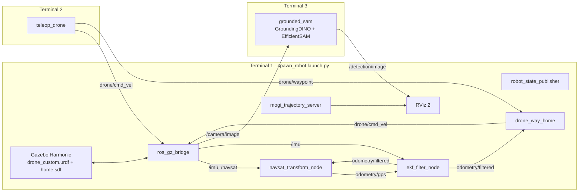

# UAV Workspace: Simulated Quadrotor with Vision-Language Perception

A ROS 2 Jazzy + Gazebo Harmonic workspace for a simulated quadrotor that:

- flies in a Gazebo world with a physics-based multicopter model (motors, IMU, GPS, front/down cameras, RGB-D),
- localizes itself with an **EKF** (`robot_localization`) that fuses IMU and GPS,
- can be **teleoperated** from the keyboard, with **waypoints** and **return-to-home**,
- runs **open-vocabulary perception** on the drone camera with **GroundingDINO + EfficientSAM** (OpenVINO),
- includes standalone **YOLOE**, **BLIP VQA** and **SmolVLM** experiments for scene understanding.

---

## Table of Contents

1. [System Architecture](#1-system-architecture)
2. [Directory Structure](#2-directory-structure)
3. [Prerequisites](#3-prerequisites)
4. [Installation (one-time)](#4-installation-one-time)
5. [Running the Project: Terminals 1, 2 and 3](#5-running-the-project-terminals-1-2-and-3)
6. [Standalone Perception Tools](#6-standalone-perception-tools)
7. [ROS 2 Interface Reference](#7-ros-2-interface-reference)
8. [Troubleshooting](#8-troubleshooting)
9. [Git Workflow and Repository Rules](#9-git-workflow-and-repository-rules)
10. [Credits and Licenses](#10-credits-and-licenses)

---

## 1. System Architecture



| Layer | Package | Role |
|-------|---------|------|
| Simulation & control | `drone_basic` | URDF, Gazebo worlds, bridge, EKF/NavSat config, teleop, waypoint and home navigation |
| Perception (ROS) | `ros2_vlm` | `grounded_sam` (text-prompted detection and segmentation), `blip_visual_qna` |
| Perception (scripts) | `yoloe`, `tools/smolvlm` | Offline YOLOE open-vocabulary segmentation and SmolVLM scene description |
| Utilities | `mogi_trajectory_server`, `bitbots_tf_buffer`, `ros2_python_extension` | Trajectory visualization in RViz and a fast TF buffer it depends on |

---

## 2. Directory Structure

```text
uav_ws/                                   # colcon workspace root (= git repo root)
├── README.md                             # this file
├── requirements.txt                      # pip deps for the perception venv (pinned)
├── .gitignore                            # ignores build/, install/, log/, venv/ and model weights
├── .gitattributes                        # line-ending and binary rules
│
├── scripts/
│   └── download_models.sh                # restores all model weights (they are not in git)
│
├── docs/
│   ├── notes/uav_dev_notes.ipynb         # dev notes: TF/EKF fixes, commands, links
│   ├── tf/tf_frames.{gv,pdf}             # TF tree snapshot (ros2 run tf2_tools view_frames)
│   └── media/grounded_sam_inference.mp4  # demo recording of GroundedSAM
│
├── src/                                  # all ROS 2 packages (colcon finds them recursively)
│   ├── drone_basic/                      # ★ main package: simulation, localization, control
│   │   ├── config/                       #   ekf.yaml, navsat_transform.yaml, gz_bridge.yaml
│   │   ├── drone_basic/                  #   nodes: teleop_drone.py, drone_way_home.py
│   │   ├── launch/                       #   spawn_robot / world / check_urdf .launch.py
│   │   ├── meshes/                       #   .dae meshes (body, propellers, sensors)
│   │   ├── rviz/                         #   RViz configs
│   │   ├── urdf/                         #   drone_custom.urdf, .gazebo plugins, materials.xacro
│   │   ├── worlds/                       #   home.sdf (default), world.sdf, empty.sdf, abc.sdf
│   │   └── docs/                         #   package images and demo videos
│   │
│   ├── perception/
│   │   ├── vlms_with_ros2_workshop/      # ROS 2 VLM nodes (OpenVINO)
│   │   │   └── ros2_vlm/                 #   package: grounded_sam, blip_visual_qna
│   │   │       └── ros2_vlm/modules/     #   GroundingDINO, EfficientSAM, checkpoints/, openvino_irs/
│   │   └── yoloe/                        # YOLOE open-vocabulary segmentation script + test images
│   │
│   └── third_party/                      # vendored upstream packages (keep changes minimal)
│       ├── mogi_trajectory_server/       #   draws EKF and ground-truth trajectories in RViz
│       ├── bitbots_tf_buffer/            #   fast non-blocking TF buffer (C++/pybind)
│       └── ros2_python_extension/        #   pybind helpers needed by bitbots_tf_buffer
│
├── tools/                                # non-ROS experiments (not built by colcon)
│   └── smolvlm/
│       ├── smolvlm_250m_int8/            #   SmolVLM2-256M OpenVINO int8 + inference script
│       └── smolvlm_500m_int8/            #   SmolVLM-500M OpenVINO int8 + inference script
│
├── venv/       (ignored)                 # Python virtual environment, contains COLCON_IGNORE
├── build/      (ignored)                 # colcon output
├── install/    (ignored)                 # colcon output, sourced at runtime
└── log/        (ignored)                 # colcon logs
```

---

## 3. Prerequisites

| Component | Version |
|-----------|---------|
| OS | Ubuntu 24.04 LTS |
| ROS 2 | **Jazzy** (desktop) |
| Simulator | **Gazebo Harmonic** (installed with `ros-jazzy-ros-gz`) |
| Python | 3.12 (system) |
| Hardware | An Intel CPU/iGPU/NPU is recommended for OpenVINO. Everything also runs on CPU. |
| Disk | About 10 GB free (venv about 8 GB, models about 3.5 GB) |

---

## 4. Installation (one-time)

### 4.1 Clone the workspace

```bash
cd ~
git clone git@github.com:muhammad7340/uav_ws.git
cd ~/uav_ws
```

### 4.2 Install ROS 2 dependencies

```bash
source /opt/ros/jazzy/setup.bash
sudo apt update
sudo apt install -y python3-colcon-common-extensions python3-rosdep python3-venv git curl unzip

# Initialize rosdep (skip `init` if you have done it before)
sudo rosdep init || true
rosdep update

# Install every apt dependency declared in the package.xml files
# (ros_gz, robot_localization, tf_transformations, xacro, cv_bridge, ...)
rosdep install --from-paths src --ignore-src -r -y
sudo apt install -y ros-jazzy-rqt-image-view
```

### 4.3 Gazebo models used by the worlds

`home.sdf` uses models such as `dumpster`, `fire_hydrant`, `cardboard_box` and `brick_box_3x1x3`.
The launch file looks for them in `~/gazebo_models`:

```bash
git clone https://github.com/muhammad7340/gazebo_models.git ~/gazebo_models
```

### 4.4 Python virtual environment (perception stack)

```bash
cd ~/uav_ws
python3 -m venv venv
touch venv/COLCON_IGNORE          # keeps colcon from scanning the venv
source venv/bin/activate
pip install --upgrade pip
pip install -r requirements.txt
deactivate
```

### 4.5 Download the model weights

The weights (about 3.5 GB) are **not stored in git**. This script fetches them from GitHub releases,
Hugging Face and Google Drive. Re-running it skips files that already exist.

```bash
cd ~/uav_ws
source venv/bin/activate
./scripts/download_models.sh            # or: vlm | yoloe | smolvlm
deactivate
```

| What | Destination |
|------|-------------|
| GroundingDINO checkpoint `groundingdino_swint_ogc.pth` | `src/perception/vlms_with_ros2_workshop/ros2_vlm/ros2_vlm/modules/checkpoints/` |
| OpenVINO IRs (GroundingDINO, EfficientSAM, BLIP) | `.../modules/openvino_irs/` |
| `bert-base-uncased` | `.../modules/bert-base-uncased/` and the Hugging Face cache |
| YOLOE `yoloe-11s-seg.pt`, `mobileclip_blt.ts` | `src/perception/yoloe/yoloe/` |
| SmolVLM int8 exports | `tools/smolvlm/smolvlm_*_int8/` |

### 4.6 Build

```bash
cd ~/uav_ws
source /opt/ros/jazzy/setup.bash
colcon build --symlink-install
```

> **`--symlink-install` is required.** `ros2_vlm` loads GroundingDINO, EfficientSAM and the
> model files from its source folder through the symlinks colcon creates.
> Run `colcon build` with the venv **deactivated**.

---

## 5. Running the Project: Terminals 1, 2 and 3

Open three terminals. Each one first runs the **setup block** for that terminal, then the run command.

### Terminal 1: Simulation, localization and RViz

```bash
cd ~/uav_ws
source /opt/ros/jazzy/setup.bash
source install/setup.bash

ros2 launch drone_basic spawn_robot.launch.py world:=abc.sdf 
```

This one launch file starts:
Gazebo (`home.sdf`) · spawns the drone · `ros_gz_bridge` · `robot_state_publisher` ·
`navsat_transform_node` + `ekf_filter_node` · `drone_way_home` · two `mogi_trajectory_server`s · RViz 2.

Useful launch arguments:

```bash
ros2 launch drone_basic spawn_robot.launch.py world:=world.sdf     # other worlds: empty.sdf, abc.sdf
ros2 launch drone_basic spawn_robot.launch.py rviz:=false          # headless RViz
ros2 launch drone_basic spawn_robot.launch.py x:=2.0 y:=-1.0 yaw:=1.57
ros2 launch drone_basic spawn_robot.launch.py --show-args          # list all args
```

### Terminal 2: Keyboard teleoperation

```bash
cd ~/uav_ws
source /opt/ros/jazzy/setup.bash
source install/setup.bash

ros2 run drone_basic teleop_drone
```

Keep this terminal focused while you fly:

| Key | Action |
|-----|--------|
| `t` / `b` | climb (+z) / descend (−z). **Press `t` first to take off.** |
| `i` / `,` | forward / backward |
| `j` / `l` | yaw left / right |
| `u` `o` `m` `.` | forward/backward while turning |
| `Shift` + `I J L <` … | strafe (holonomic mode) |
| `1`–`5` | first press **saves** a waypoint; next press **flies** there |
| `h` | **return home** (climb to 3 m, fly back, land) |
| `q`/`z`, `w`/`x`, `e`/`c` | change speed (all / linear / angular) by ±10 % |
| any other key | stop |

Sending any manual command while a waypoint or home mission is running aborts the mission.

### Terminal 3: GroundedSAM perception on the drone camera

```bash
cd ~/uav_ws
source /opt/ros/jazzy/setup.bash
source venv/bin/activate
export PYTHONPATH=$PYTHONPATH:"$VIRTUAL_ENV/lib/python3.12/site-packages"
source install/setup.bash

ros2 run ros2_vlm grounded_sam --ros-args \
  -p device:=CPU \
  -p isSegment:=False \
  -p inference_fps:=1.0 \
  -p detectionList:="['person', 'fire hydrant', 'dumpster', 'cardboard box']"
```

| Parameter | Default | Meaning |
|-----------|---------|---------|
| `device` | `CPU` | OpenVINO device: `CPU`, `GPU`, `GPU.0`, `NPU` |
| `detectionList` | `['person']` | Free-text object prompts for GroundingDINO |
| `isSegment` | `False` | `True` also runs EfficientSAM masks (slower) |
| `inference_fps` | `1.0` | How often the latest frame is processed |

The node subscribes to `/camera/image` and publishes annotated frames on `/detection/image`.

#### Optional Terminal 4: view the detections

```bash
source /opt/ros/jazzy/setup.bash
ros2 run rqt_image_view rqt_image_view /detection/image
```

You can also add an **Image** display for `/detection/image` in RViz.

### Quick checks while running

```bash
ros2 topic list
ros2 topic hz /camera/image
ros2 topic echo /odometry/filtered --once
ros2 service call /go_home std_srvs/srv/Trigger          # same as pressing 'h'
ros2 topic pub --once /drone/waypoint std_msgs/msg/String "{data: '1'}"
ros2 run tf2_tools view_frames                            # regenerate the TF tree PDF
```

---

## 6. Standalone Perception Tools

These need the venv but not the simulator. Run them in any terminal.

```bash
cd ~/uav_ws
source /opt/ros/jazzy/setup.bash
source venv/bin/activate
export PYTHONPATH=$PYTHONPATH:"$VIRTUAL_ENV/lib/python3.12/site-packages"
source install/setup.bash
```

**BLIP visual question answering (ROS node, single image):**

```bash
ros2 run ros2_vlm blip_visual_qna --ros-args \
  -p device:=CPU \
  -p question:="What is in the image?" \
  -p image_path:=$HOME/uav_ws/src/perception/yoloe/yoloe/images/image6.png
```

**YOLOE open-vocabulary segmentation** (the script uses relative paths, so `cd` into its folder first):

```bash
cd ~/uav_ws/src/perception/yoloe/yoloe
python3 yoloe.py              # writes output_result.jpg
```

**SmolVLM scene description (OpenVINO int8):**

```bash
cd ~/uav_ws/tools/smolvlm/smolvlm_500m_int8     # or smolvlm_250m_int8
python3 smolvlm_inference.py
```

**Inspect the URDF only (no Gazebo):**

```bash
ros2 launch drone_basic check_urdf.launch.py
```

---

## 7. ROS 2 Interface Reference

| Topic / Service | Type | Publisher → Subscriber |
|-----------------|------|------------------------|
| `/drone/cmd_vel` | `geometry_msgs/Twist` | teleop_drone, drone_way_home → Gazebo velocity controller |
| `/drone/waypoint` | `std_msgs/String` | teleop_drone → drone_way_home (`"1"`–`"5"`, `"home"`) |
| `/go_home` | `std_srvs/Trigger` (service) | → drone_way_home |
| `/imu` | `sensor_msgs/Imu` | Gazebo → EKF, navsat_transform |
| `/navsat` | `sensor_msgs/NavSatFix` | Gazebo → navsat_transform |
| `/odometry/gps` | `nav_msgs/Odometry` | navsat_transform → EKF |
| `/odometry/filtered` | `nav_msgs/Odometry` | EKF → drone_way_home, navsat_transform |
| `/drone/odom_ground_truth` | `nav_msgs/Odometry` | Gazebo → trajectory server (ground truth) |
| `/camera/image`, `/camera/camera_info` | `sensor_msgs/Image`, `CameraInfo` | Gazebo front camera → grounded_sam |
| `/camera_down/image` | `sensor_msgs/Image` | Gazebo downward camera |
| `/camera/depth_image`, `/camera/points` | `Image`, `PointCloud2` | Gazebo RGB-D |
| `/detection/image` | `sensor_msgs/Image` | grounded_sam → RViz / rqt_image_view |
| `/clock` | `rosgraph_msgs/Clock` | Gazebo → all nodes (`use_sim_time`) |

**TF tree:** `odom → drone/base_footprint → drone/base_link → sensors`. The EKF is the only node that
publishes `odom → base_footprint`; the Gazebo `/tf` bridge is disabled on purpose (see
[docs/notes/uav_dev_notes.ipynb](docs/notes/uav_dev_notes.ipynb) and [docs/tf/tf_frames.pdf](docs/tf/tf_frames.pdf)).

---

## 8. Troubleshooting

| Symptom | Fix |
|---------|-----|
| `Package 'drone_basic' not found` | Run `source install/setup.bash` in **every** new terminal. |
| Errors after pulling or moving packages | Clean rebuild: `rm -rf build install log && colcon build --symlink-install` |
| `ModuleNotFoundError: openvino / torch / transformers` in `ros2 run` | Activate the venv **and** run the `export PYTHONPATH=...` line (Terminal 3 block). |
| `No module named ...GroundingDINO` / model `.xml` not found | Build with `--symlink-install` and run `./scripts/download_models.sh vlm`. |
| Gazebo world has missing or pink models | Clone `gazebo_models` into `~/gazebo_models` (§4.3). |
| Gazebo window is black (VM / no GPU) | In `src/drone_basic/launch/world.launch.py`, switch to the commented `--render-engine ogre` line. |
| Drone does not move | Press `t` to take off first; check `ros2 topic echo /drone/cmd_vel`. |
| GroundedSAM is very slow | Lower `inference_fps`, keep `isSegment:=False`, try `device:=GPU`. |
| A different package version gets used | Your `~/.bashrc` may source another workspace (e.g. `~/ros2_ws`). Open a clean terminal or remove that line. |

---

## 9. Git Workflow and Repository Rules

**What is committed:** source code, `package.xml`/`setup.py`, launch files, configs, URDF/xacro, worlds,
meshes, RViz configs, small images and docs.

**What is never committed** (enforced by `.gitignore`):

- `build/`, `install/`, `log/`: regenerate with `colcon build`
- `venv/`: recreate with `pip install -r requirements.txt`
- Model weights (`*.pt`, `*.pth`, `*.onnx`, `*.safetensors`, `*.ts`, OpenVINO `openvino_irs/*.bin|xml`,
  SmolVLM exports) and `ov_cache/`: restore with `scripts/download_models.sh`

GitHub rejects files over **100 MB** and warns above 50 MB. Before every commit, check what you are adding:

```bash
git status
git diff --cached --stat
# list staged files larger than 50 MB (should print nothing)
git diff --cached --name-only -z | xargs -0 -r du -m 2>/dev/null | awk '$1 >= 50'
```

Typical workflow:

```bash
git checkout -b feature/<short-name>
# ... edit, build, test ...
git add -A
git commit -m "drone_basic: tune EKF process noise"
git push -u origin feature/<short-name>
```

Conventions:

- New ROS packages go in `src/<category>/<package_name>/` (`perception/`, `third_party/`, or a new
  category such as `control/` or `planning/`). colcon finds them automatically.
- Put **upstream code** in `src/third_party/` unmodified when possible, and note its origin below.
- Experiments that are not ROS packages go in `tools/`.
- If you add a new model, add its download step to `scripts/download_models.sh`, not the weights to git.
- Update `requirements.txt` (Python) or `package.xml` (ROS/apt) when you add a dependency.

---

## 10. Credits and Licenses

| Component | Origin | License |
|-----------|--------|---------|
| `drone_basic` | [nadasmartin/drone_basic](https://github.com/nadasmartin/drone_basic): BME Robotics Systems Lab (M. Balázs, G. M. Nádas) | Apache-2.0 |
| `mogi_trajectory_server` | [MOGI-ROS/mogi_trajectory_server](https://github.com/MOGI-ROS/mogi_trajectory_server) | Apache-2.0 |
| `bitbots_tf_buffer`, `ros2_python_extension` | [bit-bots](https://github.com/bit-bots) | MIT |
| `vlms_with_ros2_workshop` / `ros2_vlm` | [nilutpolkashyap/vlms_with_ros2_workshop](https://github.com/nilutpolkashyap/vlms_with_ros2_workshop) | MIT |
| GroundingDINO | [IDEA-Research/GroundingDINO](https://github.com/IDEA-Research/GroundingDINO) | Apache-2.0 |
| EfficientSAM | [yformer/EfficientSAM](https://github.com/yformer/EfficientSAM) | Apache-2.0 |
| YOLOE | [Ultralytics](https://github.com/ultralytics/ultralytics) | AGPL-3.0 |
| SmolVLM / SmolVLM2 | [HuggingFaceTB](https://huggingface.co/HuggingFaceTB) | Apache-2.0 |

Each vendored package keeps its own `LICENSE` and `README.md` in its folder.

Further reading: [OpenVINO VLM blog](https://huggingface.co/blog/openvino-vlm) ·
[Gazebo sensors and plugins](https://medium.com/@alitekes1/gazebo-sim-plugin-and-sensors-for-acquire-data-from-simulation-environment-681d8e2ad853) ·
[Using Python packages with ROS 2](https://docs.ros.org/en/jazzy/How-To-Guides/Using-Python-Packages.html)
