# UAV Workspace: Simulated Quadrotor with Vision-Language Perception

A ROS 2 Jazzy + Gazebo Harmonic workspace for a simulated quadrotor that:

- flies in a Gazebo world with a physics-based multicopter model (motors, IMU, GPS, front/down cameras, RGB-D),
- localizes itself with an **EKF** (`robot_localization`) that fuses IMU and GPS,
- can be **teleoperated** from the keyboard, with **waypoints** and **return-to-home**,
- runs **open-vocabulary perception** on the drone camera with **GroundingDINO + EfficientSAM** (OpenVINO),
- includes standalone **YOLOE**, **BLIP VQA** and **SmolVLM** experiments for scene understanding.

---

## Table of Contents

1. [System Architecture](#1-system-architecture)
2. [Directory Structure](#2-directory-structure)
3. [Prerequisites](#3-prerequisites)
4. [Installation (one-time)](#4-installation-one-time)
5. [Running the Project: Terminals 1, 2 and 3](#5-running-the-project-terminals-1-2-and-3)
6. [Standalone Perception Tools](#6-standalone-perception-tools)
7. [ROS 2 Interface Reference](#7-ros-2-interface-reference)
8. [Troubleshooting](#8-troubleshooting)
9. [Git Workflow and Repository Rules](#9-git-workflow-and-repository-rules)
10. [FloodScout: language-guided flood-relief scout](#10-floodscout-language-guided-flood-relief-scout)
11. [Credits and Licenses](#11-credits-and-licenses)

---

## 1. System Architecture

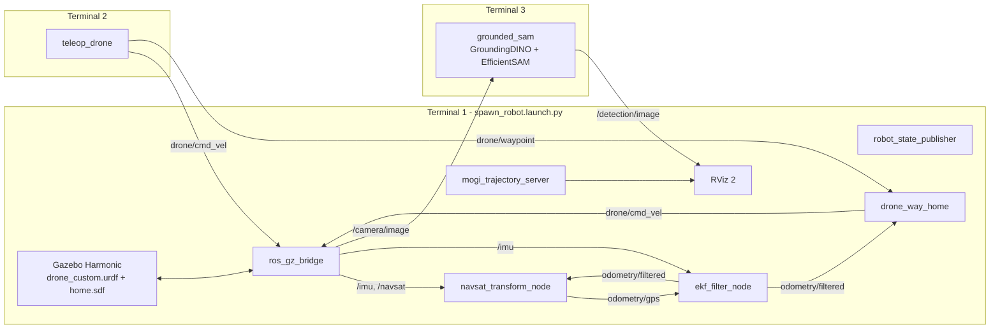

| Layer | Package | Role |
|-------|---------|------|
| Simulation & control | `drone_basic` | URDF, Gazebo worlds, bridge, EKF/NavSat config, teleop, waypoint and home navigation |
| Perception (ROS) | `ros2_vlm` | `grounded_sam` (text-prompted detection and segmentation), `blip_visual_qna` |
| Perception (scripts) | `yoloe`, `tools/smolvlm` | Offline YOLOE open-vocabulary segmentation and SmolVLM scene description |
| Utilities | `mogi_trajectory_server`, `bitbots_tf_buffer`, `ros2_python_extension` | Trajectory visualization in RViz and a fast TF buffer it depends on |

---

## 2. Directory Structure

```text
uav_ws/                                   # colcon workspace root (= git repo root)
├── README.md                             # this file
├── requirements.txt                      # pip deps for the perception venv (pinned)
├── .gitignore                            # ignores build/, install/, log/, venv/ and model weights
├── .gitattributes                        # line-ending and binary rules
│
├── scripts/
│   └── download_models.sh                # restores all model weights (they are not in git)
│
├── docs/
│   ├── notes/uav_dev_notes.ipynb         # dev notes: TF/EKF fixes, commands, links
│   ├── tf/tf_frames.{gv,pdf}             # TF tree snapshot (ros2 run tf2_tools view_frames)
│   └── media/grounded_sam_inference.mp4  # demo recording of GroundedSAM
│
├── src/                                  # all ROS 2 packages (colcon finds them recursively)
│   ├── drone_basic/                      # ★ main package: simulation, localization, control
│   │   ├── config/                       #   ekf.yaml, navsat_transform.yaml, gz_bridge.yaml
│   │   ├── drone_basic/                  #   nodes: teleop_drone.py, drone_way_home.py
│   │   ├── launch/                       #   spawn_robot / world / check_urdf .launch.py
│   │   ├── meshes/                       #   .dae meshes (body, propellers, sensors)
│   │   ├── rviz/                         #   RViz configs
│   │   ├── urdf/                         #   drone_custom.urdf, .gazebo plugins, materials.xacro
│   │   ├── worlds/                       #   home.sdf (default), world.sdf, empty.sdf, abc.sdf
│   │   └── docs/                         #   package images and demo videos
│   │
│   ├── perception/
│   │   ├── vlms_with_ros2_workshop/      # ROS 2 VLM nodes (OpenVINO)
│   │   │   └── ros2_vlm/                 #   package: grounded_sam, blip_visual_qna
│   │   │       └── ros2_vlm/modules/     #   GroundingDINO, EfficientSAM, checkpoints/, openvino_irs/
│   │   └── yoloe/                        # YOLOE open-vocabulary segmentation script + test images
│   │
│   └── third_party/                      # vendored upstream packages (keep changes minimal)
│       ├── mogi_trajectory_server/       #   draws EKF and ground-truth trajectories in RViz
│       ├── bitbots_tf_buffer/            #   fast non-blocking TF buffer (C++/pybind)
│       └── ros2_python_extension/        #   pybind helpers needed by bitbots_tf_buffer
│
├── tools/                                # non-ROS experiments (not built by colcon)
│   └── smolvlm/
│       ├── smolvlm_250m_int8/            #   SmolVLM2-256M OpenVINO int8 + inference script
│       └── smolvlm_500m_int8/            #   SmolVLM-500M OpenVINO int8 + inference script
│
├── venv/       (ignored)                 # Python virtual environment, contains COLCON_IGNORE
├── build/      (ignored)                 # colcon output
├── install/    (ignored)                 # colcon output, sourced at runtime
└── log/        (ignored)                 # colcon logs
```

---

## 3. Prerequisites

| Component | Version |
|-----------|---------|
| OS | Ubuntu 24.04 LTS |
| ROS 2 | **Jazzy** (desktop) |
| Simulator | **Gazebo Harmonic** (installed with `ros-jazzy-ros-gz`) |
| Python | 3.12 (system) |
| Hardware | An Intel CPU/iGPU/NPU is recommended for OpenVINO. Everything also runs on CPU. |
| Disk | About 10 GB free (venv about 8 GB, models about 3.5 GB) |

---

## 4. Installation (one-time)

### 4.1 Clone the workspace

```bash
cd ~
git clone git@github.com:muhammad7340/uav_ws.git
cd ~/uav_ws
```

### 4.2 Install ROS 2 dependencies

```bash
source /opt/ros/jazzy/setup.bash
sudo apt update
sudo apt install -y python3-colcon-common-extensions python3-rosdep python3-venv git curl unzip

# Initialize rosdep (skip `init` if you have done it before)
sudo rosdep init || true
rosdep update

# Install every apt dependency declared in the package.xml files
# (ros_gz, robot_localization, tf_transformations, xacro, cv_bridge, ...)
rosdep install --from-paths src --ignore-src -r -y
sudo apt install -y ros-jazzy-rqt-image-view
```

### 4.3 Gazebo models used by the worlds

`home.sdf` uses models such as `dumpster`, `fire_hydrant`, `cardboard_box` and `brick_box_3x1x3`.
The launch file looks for them in `~/gazebo_models`:

```bash
git clone https://github.com/muhammad7340/gazebo_models.git ~/gazebo_models
```

### 4.4 Python virtual environment (perception stack)

```bash
cd ~/uav_ws
python3 -m venv venv
touch venv/COLCON_IGNORE          # keeps colcon from scanning the venv
source venv/bin/activate
pip install --upgrade pip
pip install -r requirements.txt
deactivate
```

### 4.5 Download the model weights

The weights (about 3.5 GB) are **not stored in git**. This script fetches them from GitHub releases,
Hugging Face and Google Drive. Re-running it skips files that already exist.

```bash
cd ~/uav_ws
source venv/bin/activate
./scripts/download_models.sh            # or: vlm | yoloe | smolvlm
deactivate
```

| What | Destination |
|------|-------------|
| GroundingDINO checkpoint `groundingdino_swint_ogc.pth` | `src/perception/vlms_with_ros2_workshop/ros2_vlm/ros2_vlm/modules/checkpoints/` |
| OpenVINO IRs (GroundingDINO, EfficientSAM, BLIP) | `.../modules/openvino_irs/` |
| `bert-base-uncased` | `.../modules/bert-base-uncased/` and the Hugging Face cache |
| YOLOE `yoloe-11s-seg.pt`, `mobileclip_blt.ts` | `src/perception/yoloe/yoloe/` |
| SmolVLM int8 exports | `tools/smolvlm/smolvlm_*_int8/` |

### 4.6 Build

```bash
cd ~/uav_ws
source /opt/ros/jazzy/setup.bash
colcon build --symlink-install
```

> **`--symlink-install` is required.** `ros2_vlm` loads GroundingDINO, EfficientSAM and the
> model files from its source folder through the symlinks colcon creates.
> Run `colcon build` with the venv **deactivated**.

---

## 5. Running the Project: Terminals 1, 2 and 3

Open three terminals. Each one first runs the **setup block** for that terminal, then the run command.

### Terminal 1: Simulation, localization and RViz

```bash
cd ~/uav_ws
source /opt/ros/jazzy/setup.bash
source install/setup.bash

ros2 launch drone_basic spawn_robot.launch.py world:=abc.sdf 
```

This one launch file starts:
Gazebo (`home.sdf`) · spawns the drone · `ros_gz_bridge` · `robot_state_publisher` ·
`navsat_transform_node` + `ekf_filter_node` · `drone_way_home` · two `mogi_trajectory_server`s · RViz 2.

Useful launch arguments:

```bash
ros2 launch drone_basic spawn_robot.launch.py world:=world.sdf     # other worlds: empty.sdf, abc.sdf
ros2 launch drone_basic spawn_robot.launch.py rviz:=false          # headless RViz
ros2 launch drone_basic spawn_robot.launch.py x:=2.0 y:=-1.0 yaw:=1.57
ros2 launch drone_basic spawn_robot.launch.py --show-args          # list all args
```

### Terminal 2: Keyboard teleoperation

```bash
cd ~/uav_ws
source /opt/ros/jazzy/setup.bash
source install/setup.bash

ros2 run drone_basic teleop_drone
```

Keep this terminal focused while you fly:

| Key | Action |
|-----|--------|
| `t` / `b` | climb (+z) / descend (−z). **Press `t` first to take off.** |
| `i` / `,` | forward / backward |
| `j` / `l` | yaw left / right |
| `u` `o` `m` `.` | forward/backward while turning |
| `Shift` + `I J L <` … | strafe (holonomic mode) |
| `1`–`5` | first press **saves** a waypoint; next press **flies** there |
| `h` | **return home** (climb to 3 m, fly back, land) |
| `q`/`z`, `w`/`x`, `e`/`c` | change speed (all / linear / angular) by ±10 % |
| any other key | stop |

Sending any manual command while a waypoint or home mission is running aborts the mission.

### Terminal 3: GroundedSAM perception on the drone camera

```bash
cd ~/uav_ws
source /opt/ros/jazzy/setup.bash
source venv/bin/activate
export PYTHONPATH=$PYTHONPATH:"$VIRTUAL_ENV/lib/python3.12/site-packages"
source install/setup.bash

ros2 run ros2_vlm grounded_sam --ros-args \
  -p device:=CPU \
  -p isSegment:=False \
  -p inference_fps:=1.0 \
  -p detectionList:="['person', 'fire hydrant', 'dumpster', 'cardboard box']"
```

| Parameter | Default | Meaning |
|-----------|---------|---------|
| `device` | `CPU` | OpenVINO device: `CPU`, `GPU`, `GPU.0`, `NPU` |
| `detectionList` | `['person']` | Free-text object prompts for GroundingDINO |
| `isSegment` | `False` | `True` also runs EfficientSAM masks (slower) |
| `inference_fps` | `1.0` | How often the latest frame is processed |

The node subscribes to `/camera/image` and publishes annotated frames on `/detection/image`.

#### Optional Terminal 4: view the detections

```bash
source /opt/ros/jazzy/setup.bash
ros2 run rqt_image_view rqt_image_view /detection/image
```

You can also add an **Image** display for `/detection/image` in RViz.

### Quick checks while running

```bash
ros2 topic list
ros2 topic hz /camera/image
ros2 topic echo /odometry/filtered --once
ros2 service call /go_home std_srvs/srv/Trigger          # same as pressing 'h'
ros2 topic pub --once /drone/waypoint std_msgs/msg/String "{data: '1'}"
ros2 run tf2_tools view_frames                            # regenerate the TF tree PDF
```

---

## 6. Standalone Perception Tools

These need the venv but not the simulator. Run them in any terminal.

```bash
cd ~/uav_ws
source /opt/ros/jazzy/setup.bash
source venv/bin/activate
export PYTHONPATH=$PYTHONPATH:"$VIRTUAL_ENV/lib/python3.12/site-packages"
source install/setup.bash
```

**BLIP visual question answering (ROS node, single image):**

```bash
ros2 run ros2_vlm blip_visual_qna --ros-args \
  -p device:=CPU \
  -p question:="What is in the image?" \
  -p image_path:=$HOME/uav_ws/src/perception/yoloe/yoloe/images/image6.png
```

**YOLOE open-vocabulary segmentation** (the script uses relative paths, so `cd` into its folder first):

```bash
cd ~/uav_ws/src/perception/yoloe/yoloe
python3 yoloe.py              # writes output_result.jpg
```

**SmolVLM scene description (OpenVINO int8):**

```bash
cd ~/uav_ws/tools/smolvlm/smolvlm_500m_int8     # or smolvlm_250m_int8
python3 smolvlm_inference.py
```

**Inspect the URDF only (no Gazebo):**

```bash
ros2 launch drone_basic check_urdf.launch.py
```

---

## 7. ROS 2 Interface Reference

| Topic / Service | Type | Publisher → Subscriber |
|-----------------|------|------------------------|
| `/drone/cmd_vel` | `geometry_msgs/Twist` | teleop_drone, drone_way_home → Gazebo velocity controller |
| `/drone/waypoint` | `std_msgs/String` | teleop_drone → drone_way_home (`"1"`–`"5"`, `"home"`) |
| `/go_home` | `std_srvs/Trigger` (service) | → drone_way_home |
| `/imu` | `sensor_msgs/Imu` | Gazebo → EKF, navsat_transform |
| `/navsat` | `sensor_msgs/NavSatFix` | Gazebo → navsat_transform |
| `/odometry/gps` | `nav_msgs/Odometry` | navsat_transform → EKF |
| `/odometry/filtered` | `nav_msgs/Odometry` | EKF → drone_way_home, navsat_transform |
| `/drone/odom_ground_truth` | `nav_msgs/Odometry` | Gazebo → trajectory server (ground truth) |
| `/camera/image`, `/camera/camera_info` | `sensor_msgs/Image`, `CameraInfo` | Gazebo front camera → grounded_sam |
| `/camera_down/image` | `sensor_msgs/Image` | Gazebo downward camera |
| `/camera/depth_image`, `/camera/points` | `Image`, `PointCloud2` | Gazebo RGB-D |
| `/detection/image` | `sensor_msgs/Image` | grounded_sam → RViz / rqt_image_view |
| `/clock` | `rosgraph_msgs/Clock` | Gazebo → all nodes (`use_sim_time`) |

**TF tree:** `odom → drone/base_footprint → drone/base_link → sensors`. The EKF is the only node that
publishes `odom → base_footprint`; the Gazebo `/tf` bridge is disabled on purpose (see
[docs/notes/uav_dev_notes.ipynb](docs/notes/uav_dev_notes.ipynb) and [docs/tf/tf_frames.pdf](docs/tf/tf_frames.pdf)).

---

## 8. Troubleshooting

| Symptom | Fix |
|---------|-----|
| `Package 'drone_basic' not found` | Run `source install/setup.bash` in **every** new terminal. |
| Errors after pulling or moving packages | Clean rebuild: `rm -rf build install log && colcon build --symlink-install` |
| `ModuleNotFoundError: openvino / torch / transformers` in `ros2 run` | Activate the venv **and** run the `export PYTHONPATH=...` line (Terminal 3 block). |
| `No module named ...GroundingDINO` / model `.xml` not found | Build with `--symlink-install` and run `./scripts/download_models.sh vlm`. |
| Gazebo world has missing or pink models | Clone `gazebo_models` into `~/gazebo_models` (§4.3). |
| Gazebo window is black (VM / no GPU) | In `src/drone_basic/launch/world.launch.py`, switch to the commented `--render-engine ogre` line. |
| Drone does not move | Press `t` to take off first; check `ros2 topic echo /drone/cmd_vel`. |
| GroundedSAM is very slow | Lower `inference_fps`, keep `isSegment:=False`, try `device:=GPU`. |
| A different package version gets used | Your `~/.bashrc` may source another workspace (e.g. `~/ros2_ws`). Open a clean terminal or remove that line. |

---

## 9. Git Workflow and Repository Rules

**What is committed:** source code, `package.xml`/`setup.py`, launch files, configs, URDF/xacro, worlds,
meshes, RViz configs, small images and docs.

**What is never committed** (enforced by `.gitignore`):

- `build/`, `install/`, `log/`: regenerate with `colcon build`
- `venv/`: recreate with `pip install -r requirements.txt`
- Model weights (`*.pt`, `*.pth`, `*.onnx`, `*.safetensors`, `*.ts`, OpenVINO `openvino_irs/*.bin|xml`,
  SmolVLM exports) and `ov_cache/`: restore with `scripts/download_models.sh`

GitHub rejects files over **100 MB** and warns above 50 MB. Before every commit, check what you are adding:

```bash
git status
git diff --cached --stat
# list staged files larger than 50 MB (should print nothing)
git diff --cached --name-only -z | xargs -0 -r du -m 2>/dev/null | awk '$1 >= 50'
```

Typical workflow:

```bash
git checkout -b feature/<short-name>
# ... edit, build, test ...
git add -A
git commit -m "drone_basic: tune EKF process noise"
git push -u origin feature/<short-name>
```

Conventions:

- New ROS packages go in `src/<category>/<package_name>/` (`perception/`, `third_party/`, or a new
  category such as `control/` or `planning/`). colcon finds them automatically.
- Put **upstream code** in `src/third_party/` unmodified when possible, and note its origin below.
- Experiments that are not ROS packages go in `tools/`.
- If you add a new model, add its download step to `scripts/download_models.sh`, not the weights to git.
- Update `requirements.txt` (Python) or `package.xml` (ROS/apt) when you add a dependency.

---

## 10. FloodScout: language-guided flood-relief scout

A monsoon flood has hit a town. A responder types *"Find everyone who is stranded, judge who needs
help first, and mark a safe spot near each person for the rescue boat."* The drone, driven by a
**4B vision-language model** (Qwen3.5-4B, served locally with llama.cpp), plans a survey from
that sentence, finds and grounds people from 20 m, flies down to 8 m to confirm them, measures how
far each roof is above the water, ranks who needs help first, drops an orange rescue beacon on a
dry spot near each person, re-plans when the water rises mid-mission, and writes a report with a
map. Everything lives in [`src/flood_vlm`](src/flood_vlm); the plan it follows is
[`docs/notes/FLOOD_VLM_PLAN.md`](docs/notes/FLOOD_VLM_PLAN.md) and every deviation is logged in
[`src/flood_vlm/NOTES.md`](src/flood_vlm/NOTES.md).

**Demo video (95 s)**: query -> Qwen's plan -> survey with live grounding -> look-again close-ups ->
water rises -> re-plan -> beacons -> scored map. Click the still to open
[`assets/floodscout/floodscout_demo.mp4`](assets/floodscout/floodscout_demo.mp4).

[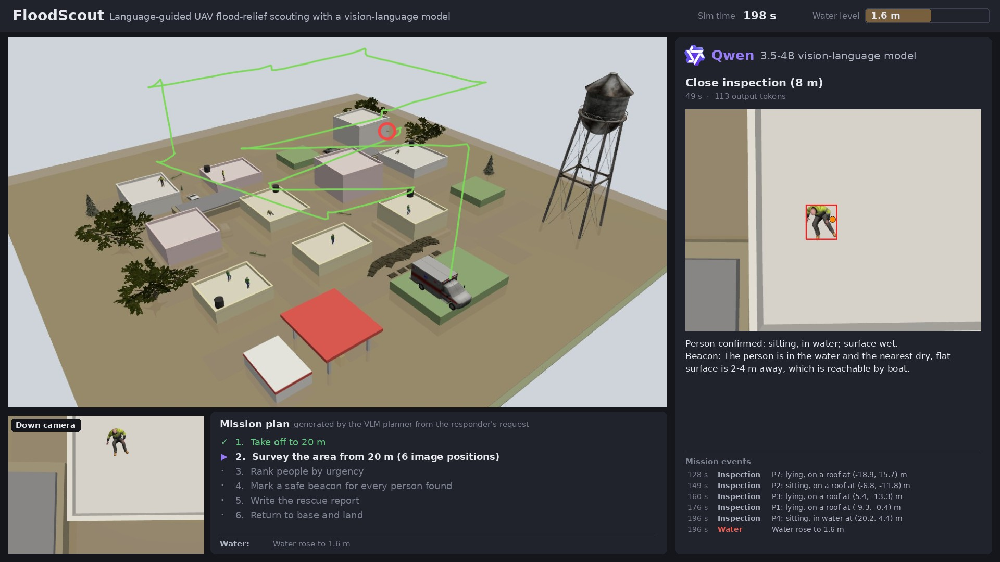](assets/floodscout/floodscout_demo.mp4)

**System overview**: one Qwen3.5-4B model plays three roles (planner, vision, triage reasoning).

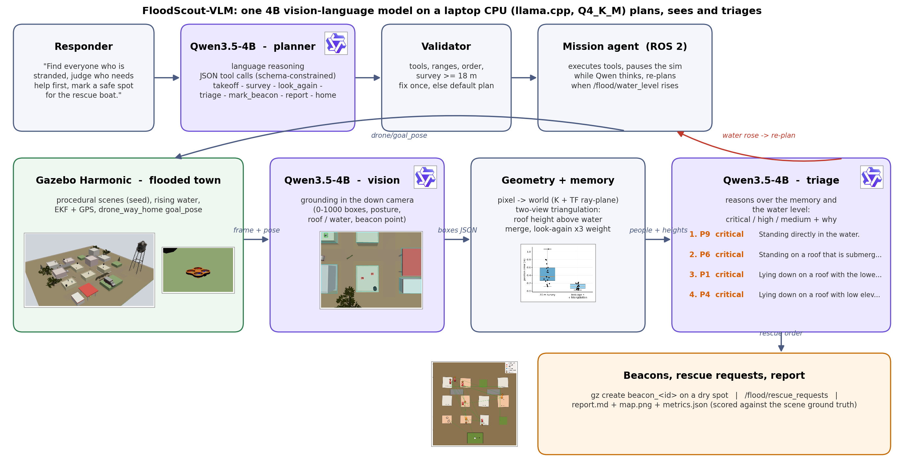

**The simulated world** (Gazebo Harmonic, procedural town, seed 7): oblique view at the start and
at the end of a mission (water at 2.4 m, orange beacons on the roofs), top-down view, and the
quadrotor on the staging mound.

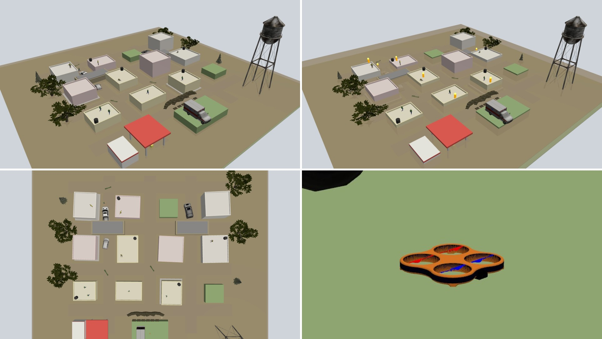

### 10.1 How it works

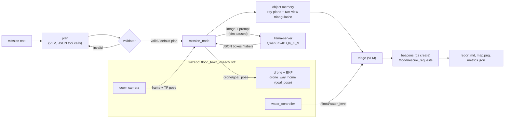

1. **Plan**: the mission text becomes `{steps: [{tool, args}]}` (tools: takeoff, survey, look_again,
   triage, mark_beacon, report, return_home), constrained to a JSON schema and checked by a validator;
   an invalid plan is sent back once with the errors, then the default plan is used.
2. **Survey** at 20 m over a 3 x 2 grid. Each box is projected into the world with the camera
   intrinsics and the EKF pose (ray-plane intersection).
3. **Look again** at 8 m over every person: confirms them, posture, roof vs water, and a beacon point.
   The two views (oblique survey + close look) are **triangulated** to measure the height the person
   is on, which is what triage needs (how far above the water is that roof?).
4. **Triage** ranks people (in water / lying = critical, roof < 1 m above water = high).
5. **Beacons** in rescue order; when `/flood/water_level` rises, triage is re-run and the remaining
   beacons re-ordered (the log says who moved up and why).
6. **Report**: ranked rescue list with crops, re-plan events, timings and metrics scored against the
   scene's ground truth.

The sim is paused while the VLM thinks, so inference time never costs flight time.

### 10.2 Run it

**One-time setup** (model weights into `~/models/qwen35`, then build):

```bash
scripts/setup_vlm.sh
```
```bash
colcon build --symlink-install --packages-select drone_basic flood_vlm
```

**Everything with one command.** Starts the model server if it is not running, launches Gazebo
with its GUI, the drone and the mission, and opens the live FloodScout dashboard (the same view as
the demo video). Press `q` in the dashboard or Ctrl-C in the terminal to stop everything; `f`
toggles fullscreen.

```bash
scripts/floodscout_demo.sh
```

Another town or another request:

```bash
scripts/floodscout_demo.sh 3 "Find the people in the water first and mark a beacon for each."
```

A mission takes about 25-30 minutes. The results land in `runs/live_seed<S>_<time>/`
(`report.md`, `map.png`, `metrics.json`, every model call in `vlm_calls.jsonl`, and the camera
recordings). Turn the run into a video with
`python3 scripts/make_video.py --run runs/live_seed<S>_<time> --out my_run.mp4`.

**Step by step** (two terminals, no dashboard):

```bash
scripts/run_vlm.sh
```
```bash
source scripts/flood_env.sh && ros2 launch flood_vlm flood_mission.launch.py seed:=7
```

Add `headless:=true` to run without the Gazebo GUI. Stop with `scripts/flood_stop.sh`, which also
removes orphaned Gazebo servers. `scripts/flood_env.sh` isolates the flood stack on
`ROS_DOMAIN_ID=42` / `GZ_PARTITION=flood_vlm`, so other simulations on the same machine are not
disturbed. New towns: `ros2 run flood_vlm scene_gen --seed 3`. Useful launch arguments:
`lookagain:=false`, `think_plan:=true`, `image_long_side:=448`, `mission:="..."`. Use the
performance power profile: in power-saver the same calls were 3-5x slower.

### 10.3 Results

All numbers: Qwen3.5-4B Q4_K_M served with llama.cpp (b12017, 6 threads, Intel i5-1235U), thinking off. Every figure and table below is regenerated by
`python3 scripts/make_paper_figures.py` from `results/`, `data/` and `runs/`; the video by
`scripts/floodscout_demo.sh` (or `scripts/record_showcase.sh 7`) and `python3 scripts/make_video.py --run <run>`.

#### Grounding (what the VLM returns)

Boxes are the model's own output, drawn on the frame it saw: green = person on a roof, red = person in
the water, cyan = dry area it proposed, orange dot = its beacon point. Top row: 20 m survey; bottom row:
8 m look-again. All 40 frames are in
[`assets/floodscout/grounding/`](assets/floodscout/grounding/).

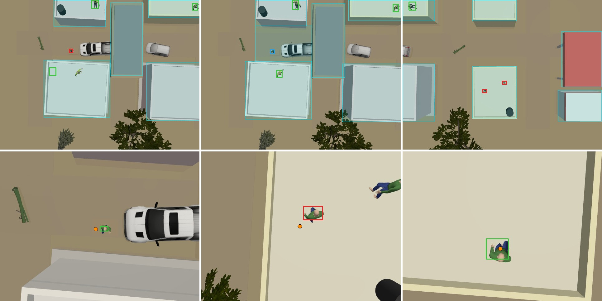

#### Closed-loop missions (seed 7, 9 stranded people, water 0.8 -> 1.6 -> 2.4 m)

| run (seed 7) | found | precision | recall | loc err survey (m) | loc err final (m) | roof/water acc | posture acc | urgency acc | Kendall tau | critical in top-k | beacons | safe beacons | re-plan correct | VLM calls (JSON err) | peak RAM (GB) |
|---|---|---|---|---|---|---|---|---|---|---|---|---|---|---|---|
| run 1 (before fixes) | 4/9 | 1.00 | 0.44 | 0.46 | 0.34 | 1.00 | 0.00 | 0.25 | 0.33 | 0.33 | 4 | 0.25 | - | 15 (0) | 9.1 |
| run 2 | 8/9 | 1.00 | 0.89 | 0.42 | 0.12 | 1.00 | 0.25 | 0.38 | 0.29 | 0.33 | 8 | 0.88 | 1.00 | 20 (0) | 10.5 |
| run 3 (recorded) | 7/9 | 1.00 | 0.78 | 0.47 | 0.13 | 1.00 | 0.57 | 0.71 | 0.33 | 0.67 | 7 | 0.71 | - | 18 (0) | 9.8 |

Run 1 is before two fixes (the planner chose a 10 m survey that leaves gaps; beacons were pushed to
exactly 1.5 m). Runs 2-3 are the final system; run 3 is the one in the video.

| mission metrics | position error per person | time budget per mission |
|---|---|---|
| 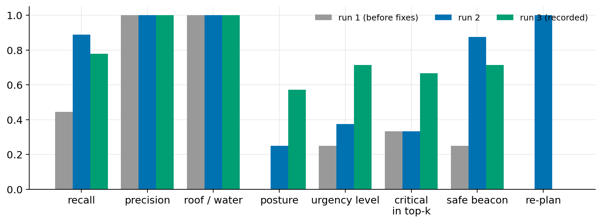 | 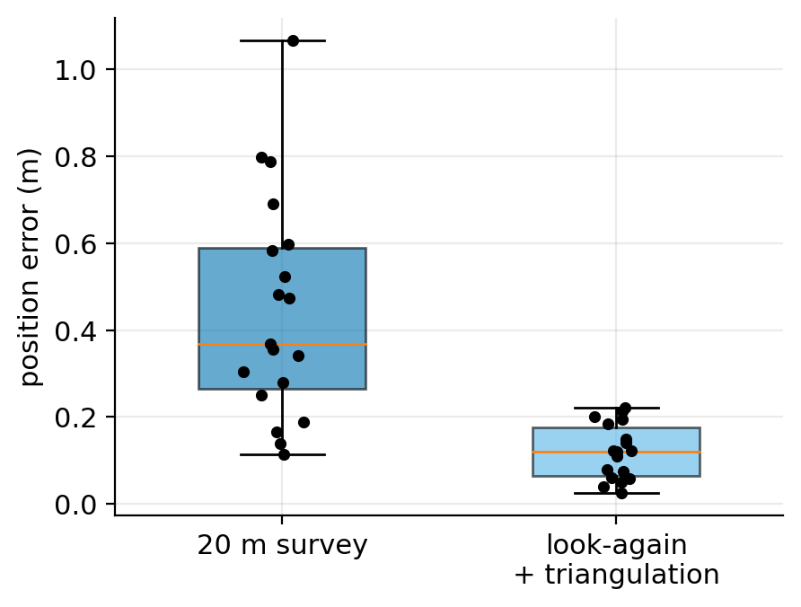 | 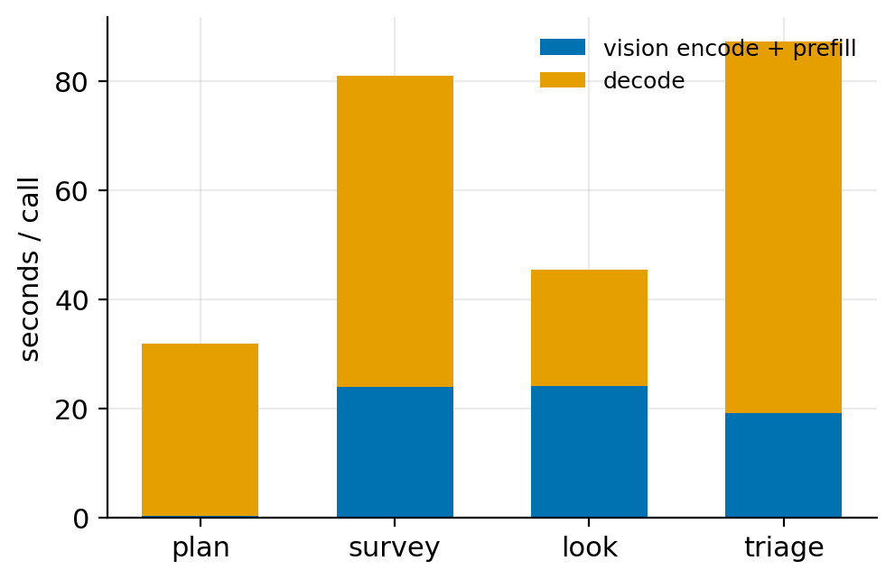 |

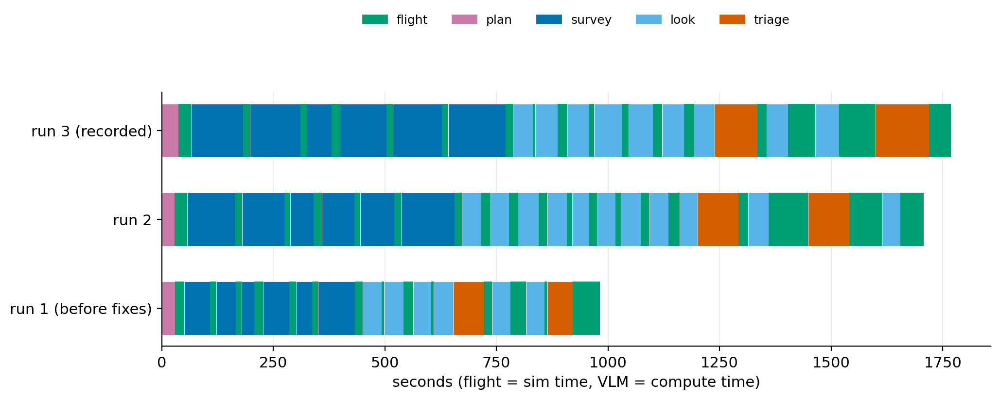

*Timeline: green = flight (sim seconds), coloured = Qwen compute per call (the sim is paused meanwhile).*

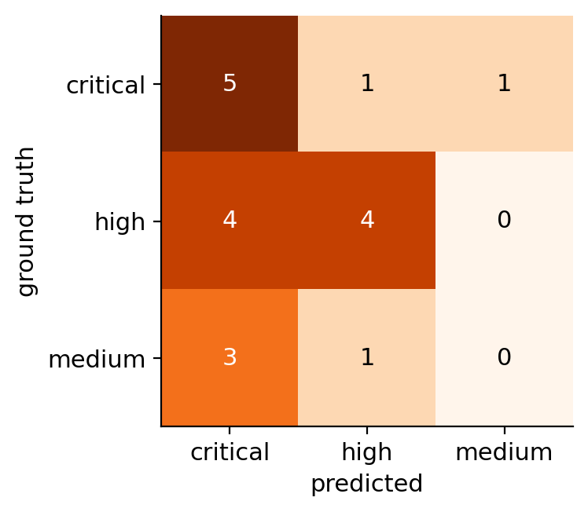

*Urgency levels from Qwen's triage vs ground truth (all three runs): rooftop people read as "lying"
are over-promoted to critical.* Survey and look-again in isolation (`scripts/try_survey.py`):

| run | cell (world m) | GT people in frame | precision | recall | loc err survey (m) | loc err look-again (m) | JSON failures |
|---|---|---|---|---|---|---|---|
| try_survey_seed7 | [-15, -15] | 3 | 1.00 | 1.00 | 0.43 | 0.41 | 0/4 |
| try_survey_seed7_nw | [-19.0, 13.0] | 3 | 1.00 | 1.00 | 0.29 | 0.10 | 0/4 |

#### Datasets

| dataset | images | questions | image size | source | answers |
|---|---|---|---|---|---|
| FloodSim-VQA (ours) | 360 | 1381 | 640 x 480 | Gazebo, 10 seeds, 20/12 m, water 0.8/2.4 m | exact, from scene GT |
| FloodNet VQA (test) | 411 | 1833 | 224 x 224 (mirror) | real UAV, Hurricane Harvey | human-labelled |

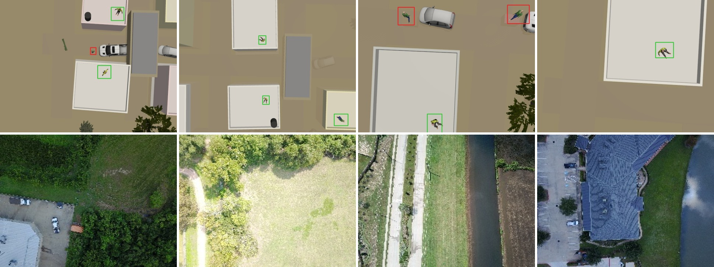

*Top: FloodSim-VQA frames (20 m and 12 m, water 0.8 and 2.4 m) with ground-truth people boxes;
bottom: FloodNet test images.*

| type | train | test | total | example question | most common answers |
|---|---|---|---|---|---|
| count | 262 | 65 | 327 | How many people are visible in this image? | 0 (174), 1 (102), 2 (42) |
| complex count | 251 | 62 | 313 | How many people are standing in flood water? | 1 (160), 0 (91), 2 (47) |
| condition | 213 | 49 | 262 | Is the road at point [53, 689] (0-1000 image coordinates) passable or flooded? | flooded (225), passable (37) |
| yes/no | 267 | 70 | 337 | Is the person nearest the centre of the image on a dry roof? | no (183), yes (154) |
| grounding | 77 | 20 | 97 | Point to the person standing in the flood water. | box (97) |
| priority | 35 | 10 | 45 | Two people are marked A and B (boxes drawn). Who needs the rescue boat first? Answer A or B. | A (26), B (19) |
| **total** | 1105 | 276 | 1381 |  |  |

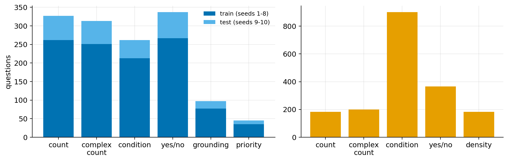

#### Visual question answering

| set | n | **all** | count | complex count | condition | yes/no | grounding | priority | density | counts +-1 | s / q |
|---|---|---|---|---|---|---|---|---|---|---|---|
| FloodSim-VQA test, 640 x 480 | 110 | 0.56 | 0.85 | 0.45 | 0.10 | 0.75 | 0.55 | 0.80 | - | 0.93 | 21.0 |
| FloodSim-VQA test, 448 px | 110 | 0.51 | 0.75 | 0.50 | 0.05 | 0.65 | 0.45 | 0.80 | - | 0.90 | 13.4 |
| FloodNet VQA test, zero-shot | 300 | 0.47 | 0.33 | 0.25 | 0.50 | 0.88 | - | - | 0.38 | 0.57 | 8.9 |
| FloodNet, "flooded area" prompt | 300 | 0.36 | 0.37 | 0.23 | 0.33 | 0.53 | - | - | 0.35 | 0.57 | 8.9 |

FloodSim road-condition questions are ~95 % "flooded" (raised roads are rarely in view); the model
answers "passable" for submerged streets that still show through the water. The last row shows what a
leading prompt costs: saying "flooded" in the prompt made the model call 27/27 dry FloodNet scenes flooded.

| accuracy per question type | effect of the prompt wording (FloodNet) |
|---|---|
| 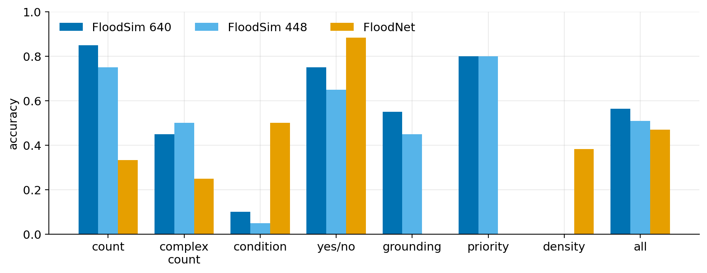 | 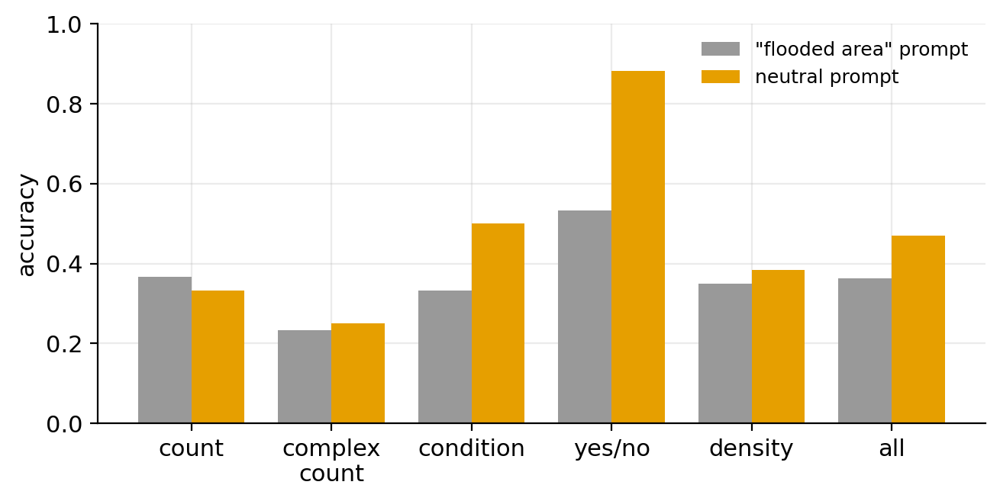 |

| counting error | road condition (FloodSim) / yes-no (FloodNet) |
|---|---|
| 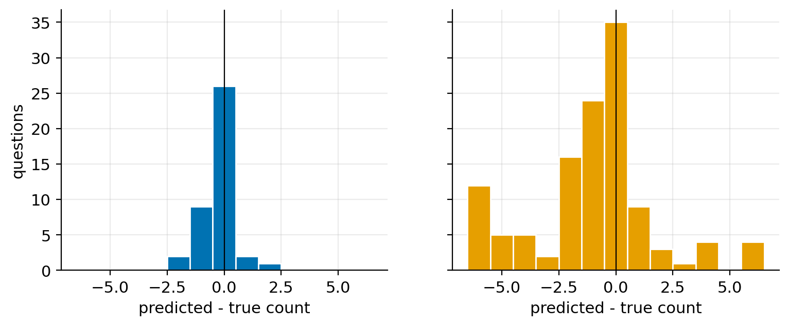 | 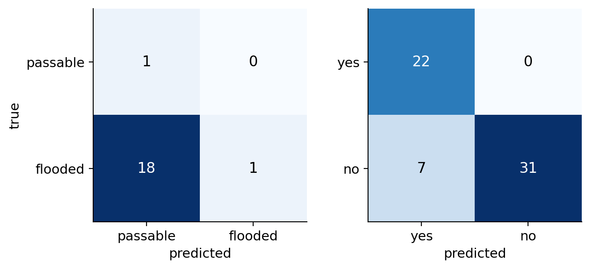 |

#### Where the inference time goes

| image | prompt tokens | prefill s | decode s | prefill share | total s | accuracy |
|---|---|---|---|---|---|---|
| 224 px | 87 | 4.4 | 2.7 | 62 % | 8.9 | 0.47 |
| 448 px | 187 | 10.1 | 3.3 | 75 % | 13.4 | 0.51 |
| 640 px | 332 | 17.8 | 2.9 | 86 % | 21.0 | 0.56 |

At 640 x 480 the image is ~330 prompt tokens and **vision encoding + prefill is 85 % of the latency**;
decoding a one-word answer takes ~3 s. Halving the pixels (448 px) cuts the time to 13.4 s for -5.5
points. Thinking mode needs > 3,000 tokens per call (> 8 min on this setup) and is off.

| latency split | accuracy vs latency |
|---|---|
| 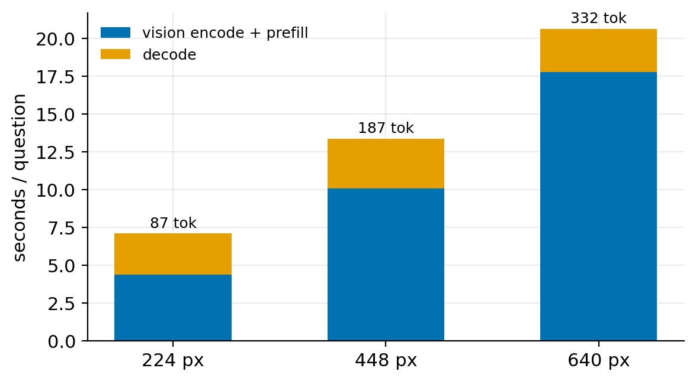 | 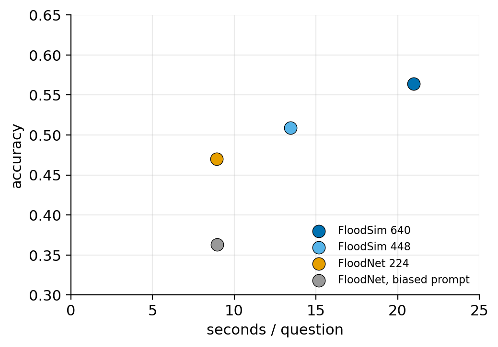 |

Not done yet: the 10-seed mission evaluation with look-again on / off and the Q8_0 quantisation
comparison. Resume with `scripts/run_phase4.sh` (resumable).

### 10.4 Datasets and evaluation

| Step | Command |
|---|---|
| FloodSim-VQA frames (10 seeds x 36 frames) | `scripts/collect_floodsim.sh 1 10` |
| FloodSim-VQA questions (+ 20 GT overlays to check) | `ros2 run flood_vlm floodsim_vqa_gen questions --check 20` |
| FloodNet VQA test split | `ros2 run flood_vlm floodnet_prep --download` |
| VQA runs | `ros2 run flood_vlm run_vqa --dataset floodsim\|floodnet --n 120 --tag q4_640` |
| Missions, look-again on/off | `ros2 run flood_vlm mission_eval --seeds 1..10 --lookagain on off` |
| Everything, resumable | `setsid nohup scripts/run_phase4.sh > results/phase4.log 2>&1 &` |
| Ablation table + plots | `python3 -m flood_vlm.eval.plots` |

### 10.5 Limitations and next steps

- **Simulated victims.** Mannequins and an animated walker on box-shaped houses; the down camera sees
  clean geometry, real floods have glare, debris, trees over people and motion blur. FloodSim-VQA and
  FloodNet ask different questions, so their scores are not directly comparable; a sim-to-real
  study needs real flights.
- **Posture from above is unreliable**: the model calls most rooftop people "lying", which makes them
  critical and flattens the triage order. Triage would benefit from posture-specific prompts on the
  close-up crop or a small posture classifier.
- **Submerged roads look like roads**: road condition ("passable or flooded") is near chance on FloodSim.
- **Inference-bound**: 20-110 s per VLM call; one mission is ~28 min of which ~2/3 is VLM time. Thinking
  mode needs > 3k tokens per call and is not usable at this speed.
- **Single drone, no payload**: beacons are spawned, not dropped; the drone's own altitude is the
  only safety margin (no obstacle avoidance).
- Next: real FloodNet-style flights, an onboard Jetson / NPU or custom accelerator for the vision
  encoder, multi-drone coverage, and a learned posture/urgency head on the VLM features.

---

## 11. Credits and Licenses

| Component | Origin | License |
|-----------|--------|---------|
| `drone_basic` | [nadasmartin/drone_basic](https://github.com/nadasmartin/drone_basic): BME Robotics Systems Lab (M. Balázs, G. M. Nádas) | Apache-2.0 |
| `mogi_trajectory_server` | [MOGI-ROS/mogi_trajectory_server](https://github.com/MOGI-ROS/mogi_trajectory_server) | Apache-2.0 |
| `bitbots_tf_buffer`, `ros2_python_extension` | [bit-bots](https://github.com/bit-bots) | MIT |
| `vlms_with_ros2_workshop` / `ros2_vlm` | [nilutpolkashyap/vlms_with_ros2_workshop](https://github.com/nilutpolkashyap/vlms_with_ros2_workshop) | MIT |
| GroundingDINO | [IDEA-Research/GroundingDINO](https://github.com/IDEA-Research/GroundingDINO) | Apache-2.0 |
| EfficientSAM | [yformer/EfficientSAM](https://github.com/yformer/EfficientSAM) | Apache-2.0 |
| YOLOE | [Ultralytics](https://github.com/ultralytics/ultralytics) | AGPL-3.0 |
| SmolVLM / SmolVLM2 | [HuggingFaceTB](https://huggingface.co/HuggingFaceTB) | Apache-2.0 |
| Qwen3.5-4B (GGUF) | [Qwen](https://huggingface.co/Qwen), quantized by [unsloth](https://huggingface.co/unsloth/Qwen3.5-4B-GGUF) | Apache-2.0 |
| llama.cpp | [ggml-org/llama.cpp](https://github.com/ggml-org/llama.cpp) | MIT |
| Rescue Randy, Ambulance, RC Boat, cars, trees, Water tower | [Gazebo Fuel / OpenRobotics](https://app.gazebosim.org/OpenRobotics) | CC0 / CC-BY 4.0 |
| `flood_people/walk.dae`, `flood_sandbags` | copied from `nav_ws2` (Gazebo actor sample, sandbag mesh) | see source |
| `flood_driftwood` | Quaternius Ultimate Nature Pack, via Swishy | CC0 |
| FloodNet VQA | [BinaLab/FloodNet](https://github.com/BinaLab/FloodNet-Challenge-EARTHVISION2021), mirror [ljx620/FloodNet-VQA](https://huggingface.co/datasets/ljx620/FloodNet-VQA) | CC BY-SA 4.0 |

Each vendored package keeps its own `LICENSE` and `README.md` in its folder.

Further reading: [OpenVINO VLM blog](https://huggingface.co/blog/openvino-vlm) ·
[Gazebo sensors and plugins](https://medium.com/@alitekes1/gazebo-sim-plugin-and-sensors-for-acquire-data-from-simulation-environment-681d8e2ad853) ·
[Using Python packages with ROS 2](https://docs.ros.org/en/jazzy/How-To-Guides/Using-Python-Packages.html)
